<div align="center">

# AnimatedPrime

**Animation. Reimagined.**

A cinematic landing page for a premium animated-film and anime streaming service — a
scroll-driven story in nine chapters, told with GSAP, WebGL and a type system that
behaves on a two-core phone as well as it does on a workstation.

`Next.js 15` · `React 19` · `TypeScript` · `Tailwind CSS 4` · `GSAP 3` · `three.js`

</div>

---

<p align="center">
  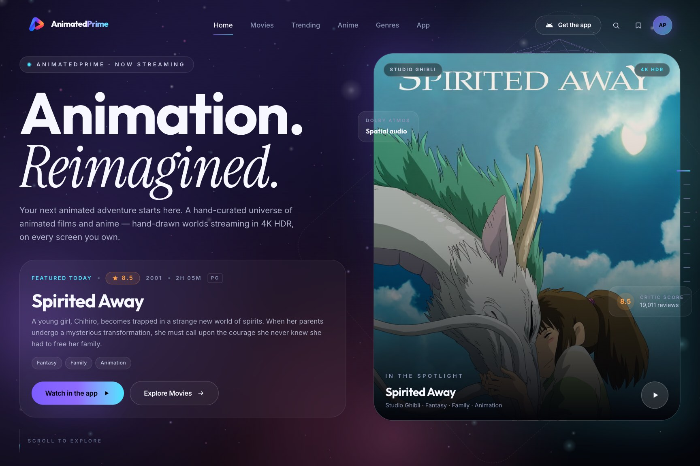
</p>

## Contents

- [What it is](#what-it-is)
- [Screenshots](#screenshots)
- [The engineering worth talking about](#the-engineering-worth-talking-about)
- [Tech stack](#tech-stack)
- [Getting started](#getting-started)
- [Environment variables](#environment-variables)
- [The Android release](#the-android-release)
- [Project structure](#project-structure)
- [Scripts](#scripts)

## What it is

AnimatedPrime is a front end for a streaming product that does not exist — which makes it
an unusually honest place to solve rendering problems, because there is no backend to
blame. Everything on the page is real: the catalogue, the artwork, the download the
"Get the app" button hands you.

| Chapter | Section | What it does |
| ------- | ------- | ------------ |
| — | Opening curtain | A projector iris, a reel counter that climbs to 100, and a lift that hands the stage to the hero. Shown once per session and skipped entirely for reduced-motion users. |
| 01 | Featured | The current pick, with scroll-scrubbed frame drift and a stacked artwork panel. |
| 02 | Trending | "What the whole family is watching this week" — a rail of real titles from the catalogue. |
| 03 | Anime | A second shelf, so the library reads as films *and* anime. |
| 04 | Genres | Eight doorways that steer the explorer below instead of navigating away. |
| 05 | The world | A WebGL corridor of poster planes you fly through as you scroll. |
| 06 | Why AnimatedPrime | Feature grid with scroll-triggered counters. |
| 07 | In your pocket | The Android app: version, size and SHA-256 read from the shipped artifact. |
| 08 | Explore | Search, genre chips and sorting over the whole catalogue, plus a watchlist and a player overlay. |
| 09 | Start | The closing call to action, wired to the real release. |

Around the story: a chapter rail down the right edge, an intent-aware custom cursor
("View", "Play", "Drag"), a projector-room ticker band, and a footer that attributes the
metadata source it actually used.

## Screenshots

Captured from a production build at 1440 × 960 with the desktop profile, and at 390 × 844
for the phone views — see [Scripts](#scripts) to regenerate them.

<table>
  <tr>
    <td width="50%">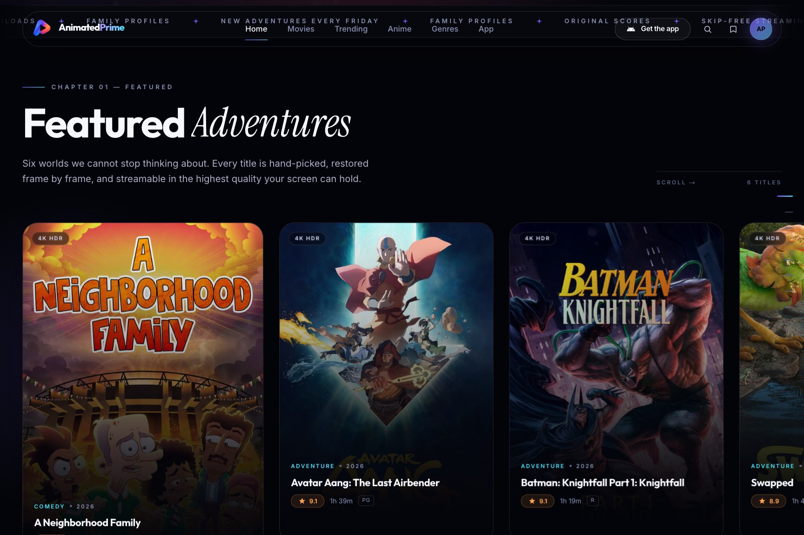</td>
    <td width="50%">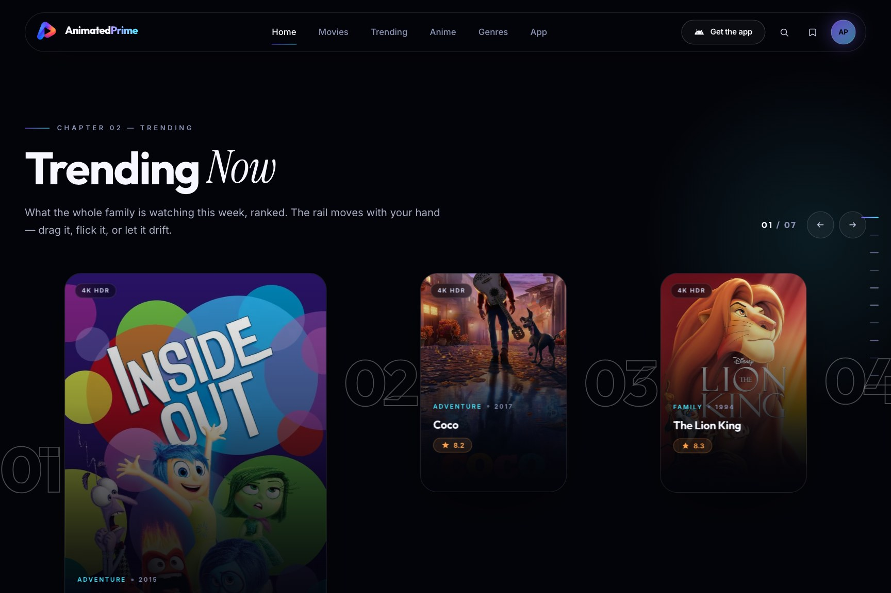</td>
  </tr>
  <tr>
    <td><sub><b>01 — Featured.</b> The current pick, with the artwork panel scrubbed by scroll.</sub></td>
    <td><sub><b>02 — Trending.</b> This week's rail, built from the live catalogue.</sub></td>
  </tr>
  <tr>
    <td>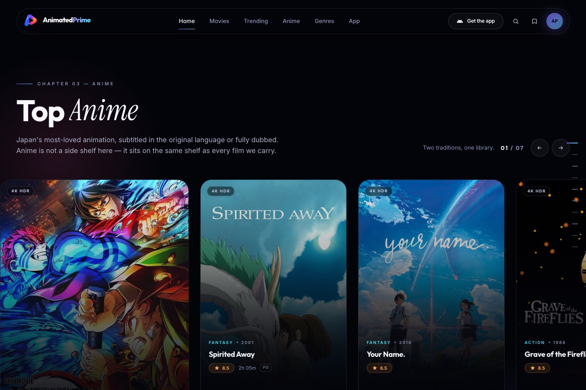</td>
    <td>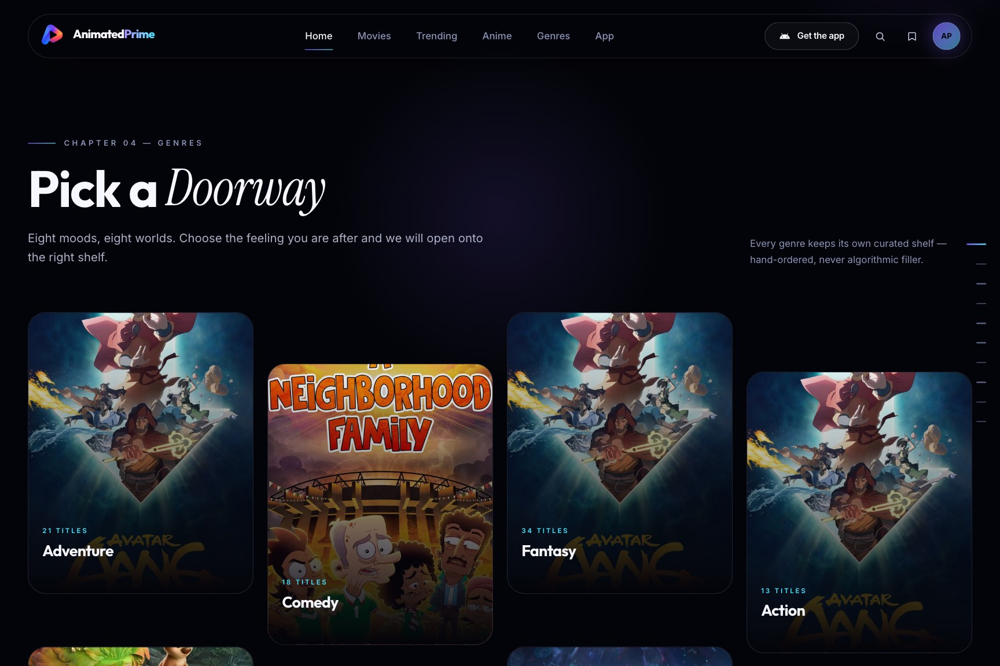</td>
  </tr>
  <tr>
    <td><sub><b>03 — Anime.</b> A dedicated shelf, not a filtered clone of Trending.</sub></td>
    <td><sub><b>04 — Genres.</b> Eight doorways that set the explorer's filter.</sub></td>
  </tr>
  <tr>
    <td>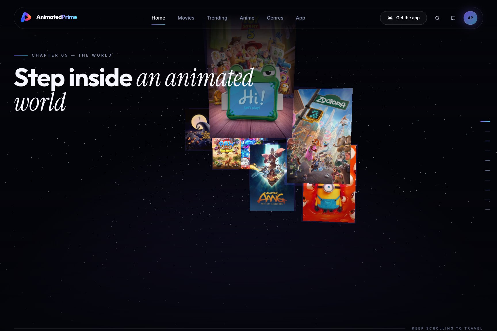</td>
    <td>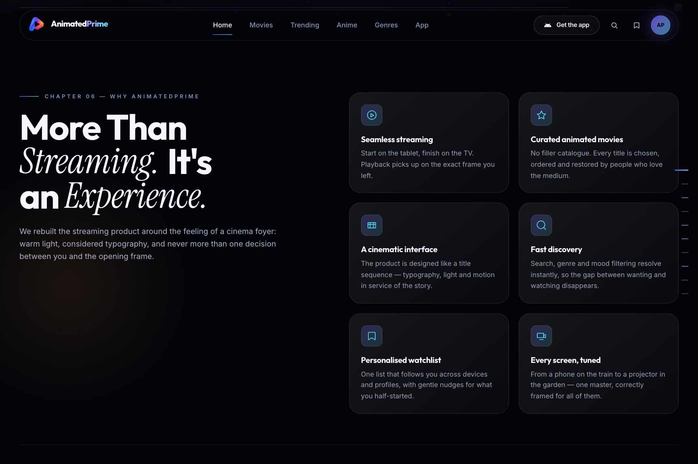</td>
  </tr>
  <tr>
    <td><sub><b>05 — The world.</b> Poster planes in a 3D corridor, driven by scroll.</sub></td>
    <td><sub><b>06 — Why.</b> Feature grid with counters that run on entry.</sub></td>
  </tr>
  <tr>
    <td>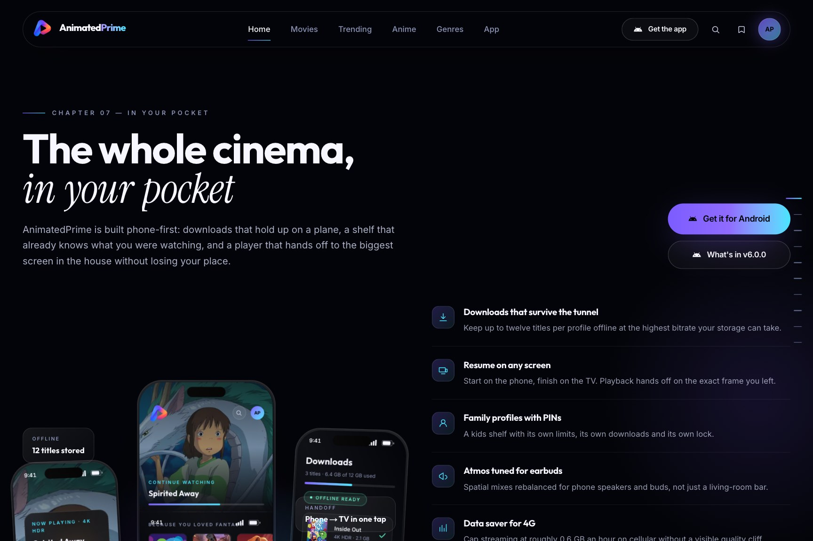</td>
    <td>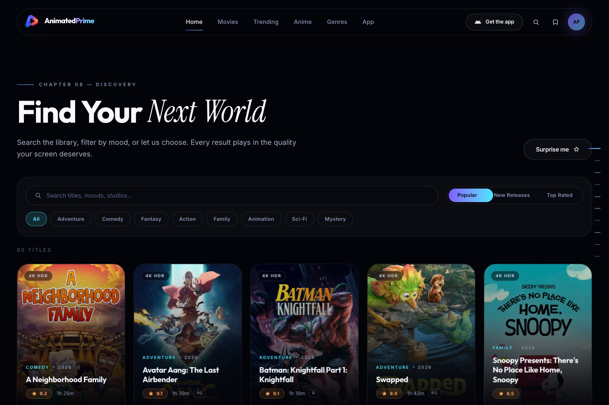</td>
  </tr>
  <tr>
    <td><sub><b>07 — The app.</b> Real release facts: version, size and checksum.</sub></td>
    <td><sub><b>08 — Explore.</b> Search, genres and sorting across the catalogue.</sub></td>
  </tr>
  <tr>
    <td>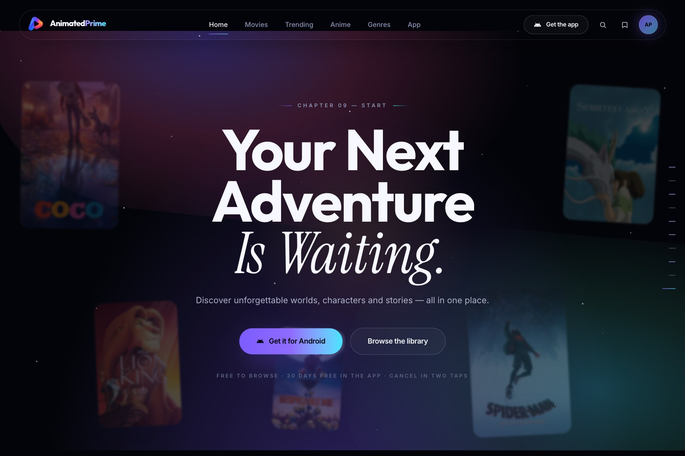</td>
    <td>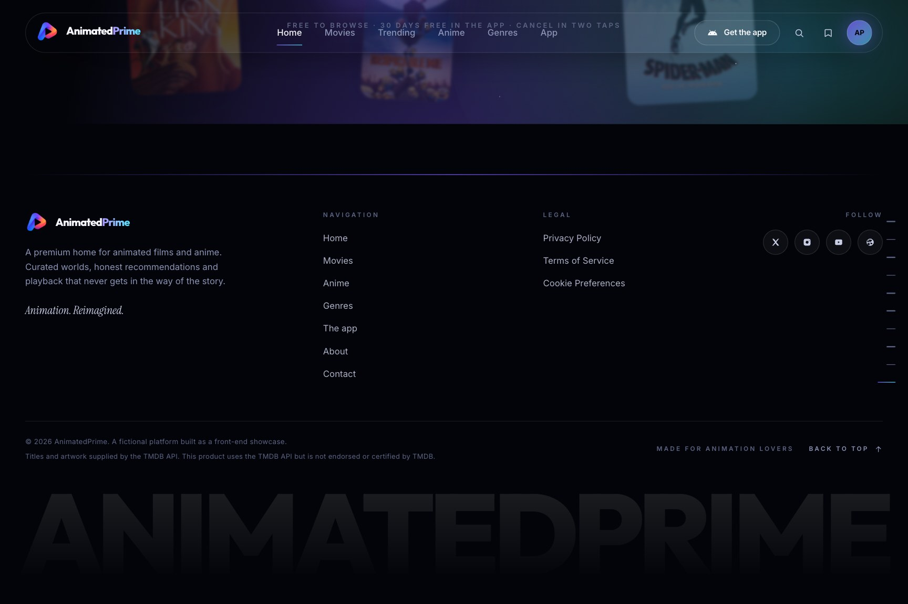</td>
  </tr>
  <tr>
    <td><sub><b>09 — Start.</b> The closing call, wired to the shipped build.</sub></td>
    <td><sub><b>Footer.</b> Links, socials and the metadata attribution.</sub></td>
  </tr>
</table>

<p align="center">
  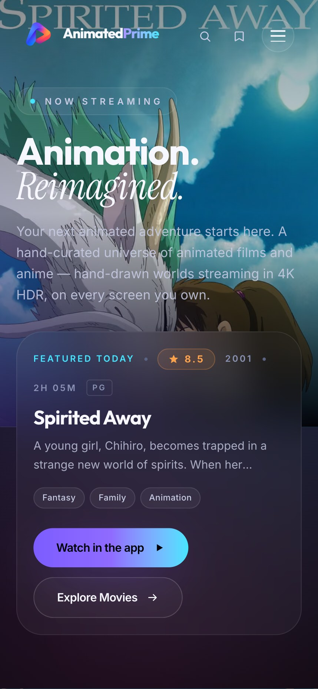
  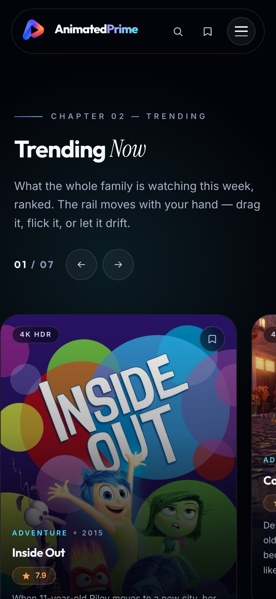
  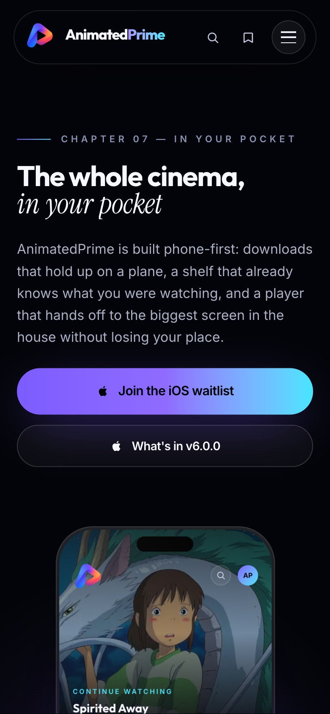
  <br />
  <sub>The same chapters at 390 × 844, where the budget lands on the <code>balanced</code> tier.</sub>
</p>

## The engineering worth talking about

### The animation budget follows the device, not the viewport

The site's layout always responded to viewport width. Its **cost** did not: the motion
budget keyed off `!isDesktop`, so a 1440px-wide laptop with two cores and 4GB of RAM was
served the same work as a workstation — dual high-DPR canvases, hundreds of particles, a
dozen blur layers, six infinite tweens and transform-driven smooth scrolling that
re-rasterises the document every frame.

A budgeted tier (`src/lib/perf.ts`) replaces that. Every expensive effect reads one of its
flags, so the cheap path is consistent and can be reasoned about in one place:

| | `high` | `balanced` | `lite` |
| --- | --- | --- | --- |
| Smooth scroll | yes | yes | **no** — native scroll |
| Backdrop glass, film grain | yes | yes | **no** |
| Ambient/decorative loops | yes | yes | **no** |
| Hero atmosphere | live | live | **one rendered frame** |
| WebGL corridor | 60fps | 60fps | **24fps, fewer planes** |
| Renderer pixel ratio | 1.7 | 1.35 | 1.0 |
| Particle / poster density | 100% | 50% | 28% |
| Opening curtain length | 100% | 62% | 40% |

Two inputs decide it: **capability** (cores, `deviceMemory`, data-saver, pointer type, and
`prefers-reduced-motion`, which is treated as a low-tier device because the calm path is
also the cheap path) and **observed frame health** — a watchdog samples real frame
durations and demotes a tier when the page cannot hold 45fps for two sustained windows.
Hardware hints lie and Safari does not report them at all; the device's own timing is the
only signal that is always true.

Any tier can be forced on any machine to reproduce a report:

```js
localStorage.setItem("animatedprime:perf", "lite"); // then reload
```

### The light is gradients, not blurs

Every wide `blur()` layer — the aura washes behind the hero, the CTA and each chapter —
became a static radial gradient. The light looks the same; the difference is that a
120–160px-radius blur on a 46rem layer is re-rasterised every frame it animates, and a
gradient is composited. On the `lite` tier the backdrop filters, the grain and the
shimmer sweeps drop out entirely, and the tier is mirrored onto `<html data-perf="lite">`
so CSS can shed that paint cost without a React branch per component.

### Type and canvas under the same budget

Split-text headings release their `will-change` once the entrance has landed rather than
holding a compositor layer for the life of the page. The WebGL scenes take the tier's
pixel ratio, density and frame ceiling as props, so a corridor that would run at 60fps
runs at 24 with fewer planes instead of stuttering. Poster art in the corridor is painted
to a canvas synchronously and the official image is swapped in when it arrives, so the 3D
scene is never full of empty planes — even with no API key and no network.

## Tech stack

| Layer | Choice |
| ----- | ------ |
| Framework | Next.js 15 (App Router, React Server Components) |
| UI | React 19, TypeScript 5.9 strict |
| Styling | Tailwind CSS 4 (`@tailwindcss/postcss`), custom `@theme` tokens |
| Motion | GSAP 3 with ScrollTrigger, ScrollSmoother and SplitText via `@gsap/react` |
| 3D | three.js with `@react-three/fiber` and `@react-three/drei` |
| Type | `next/font` — Outfit (display), Inter (UI), Instrument Serif (story italics) |
| Images | `next/image` with AVIF/WebP and a 30-day cache TTL |
| Metadata | TMDB, with a curated offline catalogue as the fallback |

## Getting started

Requires Node 20 or newer (Next.js 15 needs at least 18.18).

```bash
npm install
cp .env.example .env.local   # optional — the site runs on the offline catalogue without it
npm run dev                  # http://localhost:3000
```

Nothing in `.env.local` is required for the site to render, which is the point: with no
keys configured you get the curated catalogue and the "notify me" waitlist flow instead of
a download. Add a TMDB key and the shelves fill with live titles and official artwork.

```bash
npm run build     # production build
npm start         # serve it
npm run typecheck # tsc --noEmit
```

## Environment variables

| Variable | Purpose |
| -------- | ------- |
| `TMDB_API_KEY` | TMDB v3 API key for live metadata and posters. |
| `TMDB_ACCESS_TOKEN` | TMDB v4 read access token, if you prefer it — takes precedence. |
| `ANDROID_APK_URL` | Hosted build, used when no APK ships in `public/downloads`. |
| `ANDROID_APK_VERSION` | Fallback version when the file name carries none. |
| `ANDROID_APK_CHANNEL` | `stable` or `beta`. |
| `ANDROID_MIN_ANDROID` / `ANDROID_TARGET_ANDROID` | OS levels shown in the install steps. Read them off the build with `aapt2 dump badging`. |
| `ANDROID_APK_SIZE` / `ANDROID_APK_SHA256` / `ANDROID_APK_RELEASED_AT` | Overrides for a remotely hosted artifact. |
| `ANDROID_APK_MIRROR_URL` / `ANDROID_APK_MIRROR_LABEL` | A second public route to the same build. |

## The Android release

The site reports what it can actually find, in this order:

1. an APK in `public/downloads` — version from the file name, size and SHA-256 **streamed
   from the bytes**, so the dialog's numbers are measured facts;
2. `ANDROID_APK_URL` for a build hosted elsewhere;
3. neither — and the download dialog becomes a waitlist form instead of a dead link.

The dialog can also re-check on demand through `GET /api/release`, so the copy can never
drift into a hard-coded lie. APKs are git-ignored, which means a fresh clone ships without
one: set `ANDROID_APK_MIRROR_URL` so those deploys still hand people the app. See
[`public/downloads/README.md`](public/downloads/README.md) for the artifact contract.

## Project structure

```
src/
├─ app/                     layout, page and the two route handlers
│  ├─ api/notify/           waitlist capture (validated, logged, no storage)
│  └─ api/release/          release facts, with ?refresh=1 to re-resolve
├─ components/
│  ├─ anim/                 Reveal, Parallax, HoverParallax, TiltCard, AnimatedHeading…
│  ├─ art/                  generated key art, painted to canvas
│  ├─ providers/            App, Catalog, Explorer, Watchlist, Player, Perf
│  ├─ site/                 the chapters, plus the cursor, rail, ticker and dialogs
│  ├─ three/                hero atmosphere, WebGL corridor, frame budget
│  └─ ui/                   Logo, Pill, SectionHeader
├─ hooks/                   media queries, in-view, active section, drag scroll, textures
└─ lib/                     perf tiers, GSAP registration, catalogue, TMDB, release, palettes
```

## Scripts

| Command | Description |
| ------- | ----------- |
| `npm run dev` | Development server with hot reload. |
| `npm run build` | Production build. |
| `npm start` | Serve the production build. |
| `npm run typecheck` | `tsc --noEmit`. |
| `node scripts/capture-screenshots.mjs` | Regenerate the images in this README. |

The screenshot harness drives a local Chrome over the DevTools protocol with no
Playwright or Puppeteer dependency, so it works with whatever Chromium is already on the
machine (`CHROME_PATH` overrides the search). Because the page is animation-heavy it waits
for real behaviour rather than a fixed timer — the curtain has to finish, sections are
reached with genuine wheel events because the smooth scroller ignores jumps in
`scrollTop`, and every capture then **verifies itself**: the harness asserts that the
section it meant to frame is the one in view, and reads the bytes back to check for
spread, colour and detail, so a blank or mis-framed shot fails the run instead of quietly
shipping.

```bash
npm run build && npx next start -p 3111
node scripts/capture-screenshots.mjs                  # all shots → docs/screenshots
node scripts/capture-screenshots.mjs --only hero,cta  # a subset
node scripts/capture-screenshots.mjs --tier lite      # force a tier
node scripts/capture-screenshots.mjs --lossless       # PNG instead of JPEG
```

## Credits

Film titles, artwork and metadata come from [TMDB](https://www.themoviedb.org/), whose
terms require the attribution shown in the footer. This product uses the TMDB API but is
not endorsed or certified by TMDB. Fonts are served through `next/font` (Outfit, Inter,
Instrument Serif). AnimatedPrime is a fictional service built as a front-end showcase.
